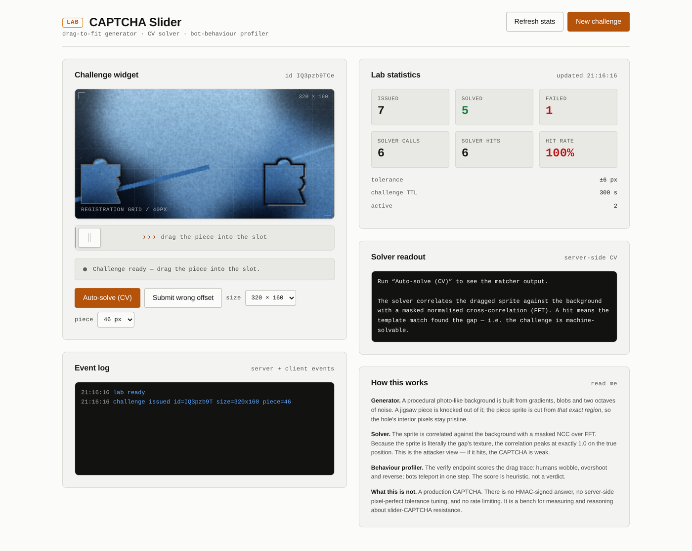
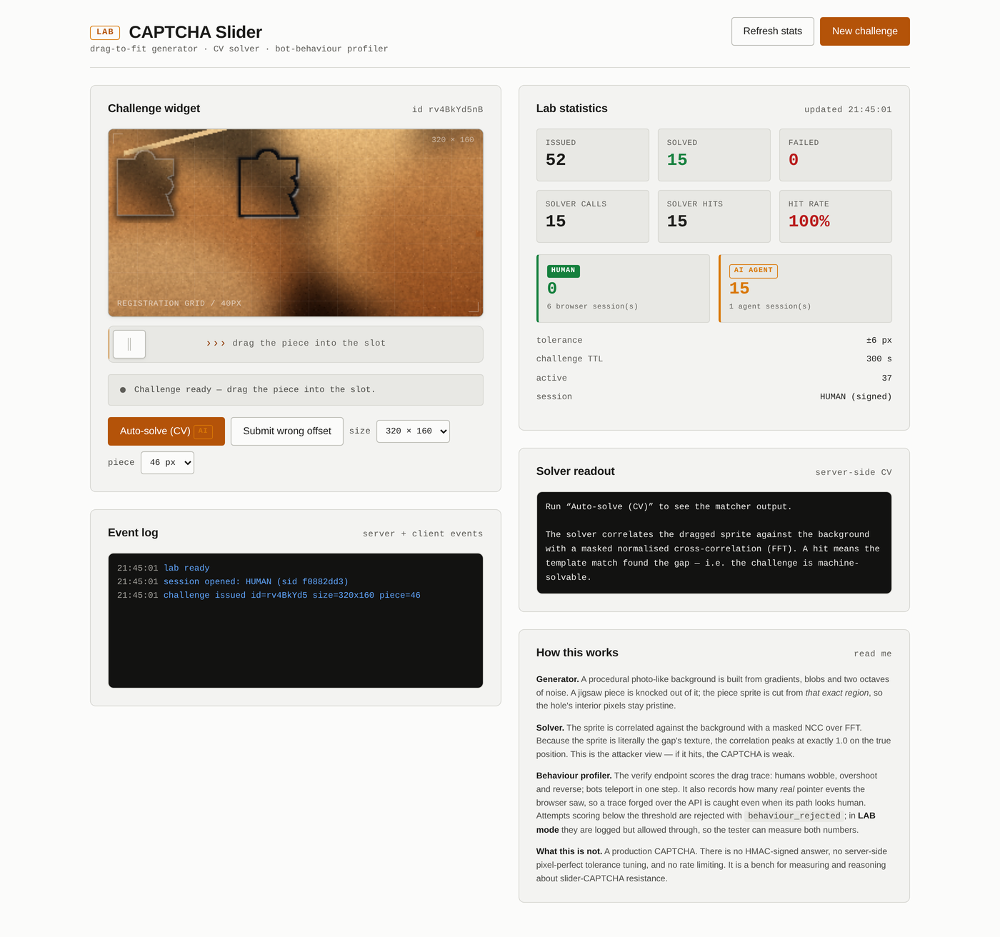

# CAPTCHA Lab — slider puzzle generator & attacker tester

[ES](README.md) · [EN](#captcha-lab--slider-puzzle-generator--attacker-tester)

> **A CAPTCHA is only as strong as its weakest attacker.**
> This project builds the CAPTCHA *and* the attacker that breaks it, then reports
> both numbers honestly.



A generator and test bench for **slider** CAPTCHAs (drag-to-fit): the challenge used
by nearly every company today — a puzzle piece you have to drag into its gap.

The lab has **two halves**, and that is the whole point:

| Half | What it does | Why it matters |
|---|---|---|
| **Generator** | Emits real challenges: procedural background, jigsaw piece, gap, track, behavioural scoring | The challenge has to be **solvable by a person** and **not trivially solvable by a machine** |
| **Tester** | Runs attacks against the widget and measures what breaks it | A CAPTCHA a bot solves is not a CAPTCHA: it is a decorated form |

---

## What this lab actually proves (with numbers, not opinions)

**Part I — slider (drag-to-fit):**

| Metric | Value | What it means |
|---|---|---|
| CV solver | **40/40 exact, 0 px error** | A naive matcher finds the gap every time → position was never the problem |
| Attacks in production mode | **12/15 blocked** | The 3 that get through are `humanish`: an attack indistinguishable from a person |
| Attribution | **15/15 → AI AGENT, 0 → HUMAN** | The server knows *who* solved it, using signed tokens |
| Solver latency | ~120 ms | Fast enough for production... which is exactly why you need the behavioural gate |

**Part II — multi-type bench (text, grid, image):**

| Family | Challenge | Exact | Per unit | Cost |
|---|---|---|---|---|
| text | transcribe characters | **77%** | 89% per character | ~2.2 s |
| grid | select all X (3×3) | **100%** | 100% per cell | ~200 ms |
| image | click the image with X | **97%** | 97% | ~140 ms |

The Part II finding is not that challenges break — it is that **they break in
different ways**: text falls to inference cost, grid to combinatorial arithmetic,
and single-image to segmentation. See
[Multi-type bench](#part-ii--multi-type-challenge-bench).

The conclusion is uncomfortable, and it is the point of the whole lab:

> **A CAPTCHA without server-side attestation is a decorated form.**
> This repo contains the evidence for why that is true, measured.

### Differentiator: telling humans and AI apart



Session tokens are **HMAC-SHA256 signed**, and the type (`human` / `ai_agent`) is
**inside the signature**: an agent cannot relabel its own token as human. The
*Auto-solve* button books the resolution as AI even when a person is sitting
right in front of the browser.

---

## Two repos, two halves

This repo and [`Challenge-captcha`](https://github.com/santilpz28/Challenge-captcha)
are split on purpose:

| Repo | What it is | What it is NOT |
|---|---|---|
| **`captcha-lab`** (this) | The **laboratory**: challenge generator, FastAPI server with UI, human/AI attribution, signed tokens, test bench | Not an attacker |
| **`Challenge-captcha`** | The **attacker**: solvers, human trace engine, HTTP client, browser mode, segmentation | Not a server, UI or generator |

The reason is methodological: **a bench that ships its own attacker measures
nothing**. If the generator and the attacker share code, the result says more
about the shared code than about the difficulty of the challenge.

So the attacker is autonomous: it imports the **contract**
(`Challenge`/`Attempt`) and nothing else from the generator. And this bench
calls the real attacker, not a copy of it.

The feature files (Hu moments, reference signatures) and the segmenter exist in
both repos because **both sides must measure the same thing**: if the generator
labels ground truth with one classifier and the attacker guesses with another,
the bench measures the difference between two classifiers instead of the
difficulty of the challenge.

---

## Quick start

```bash
git clone https://github.com/santilpz28/captcha-lab.git
cd captcha-lab
pip install -r requirements.txt

python3 -m uvicorn app.server:app --host 127.0.0.1 --port 8099
# → http://127.0.0.1:8099
```

For the bot tests: `playwright install chromium`.

```bash
python3 tests/test_e2e.py                                  # 40 assertions
python3 tests/test_bot.py --runs 3 --json out/bot.json     # 5 attack strategies
```

---

## API

### `GET /api/session?kind=human|ai_agent`

Opens a session and returns a **signed token** — the mechanism that tells a human
resolution apart from an AI one:

```jsonc
{
  "token": "lab_hu…Mm_…",
  "session": {
    "kind": "human", "label": "HUMAN",
    "sid": "44ea8b8c1f3a9d02",
    "issued_at": 1793569070.4, "expires_at": 1793572670.4
  },
  "expires_in": 3600
}
```

- The prefix is human-readable (`lab_human.` / `lab_ai_agent.`).
- The signature is **HMAC-SHA256** over `kind.payload` with the server secret.
- 1 hour TTL.

> **Why this matters:** the type is *inside the signature*. An agent cannot
> relabel its token as `human` — the server rejects the bad signature. If the type
> were just a payload field, the human/AI distinction would be theatre.

Every flow carries the token in `Authorization: Bearer <token>`:
`/api/challenge`, `/api/verify` and `/api/agent/solve`.

### `GET /api/challenge?width=320&height=160&piece_size=46`

Issues a challenge. Returns the background and the piece as data URLs, plus the
geometry the client needs to place the piece:

```jsonc
{
  "challenge_id": "…",
  "background": "data:image/png;base64,…",
  "piece":      "data:image/png;base64,…",
  "width": 320, "height": 160, "piece_size": 46,
  "sprite": {            // geometry of the piece PNG
    "w": 69, "h": 69,    //   natural PNG size (includes halo)
    "opaque_x": 8, "opaque_y": 8,   // opaque box inside the PNG
    "opaque_w": 47, "opaque_h": 54
  },
  "piece_rest": {"x": 8,  "y": 45},   // rest position (canvas px)
  "travel":    {"x": 143, "y": 0},   // travel to the gap
  "shape_centre": {"x": 174, "y": 81},  // shape centre (the verify reference)
  "session": {"kind": "human", "label": "HUMAN", "sid": "44ea8b8c…"},
  "expires_in": 300
}
```

> **The gap never travels in the payload.** The ground truth stays on the server.

### `POST /api/verify`

```jsonc
{
  "challenge_id": "…",
  "x": 174, "y": 81,        // shape centre in canvas pixels
  "trace": [{"x": 12, "y": 300, "t": 0}, …],   // drag trajectory
  "duration_ms": 940,
  "pointer_events": 41      // pointer events reported by the client
}
```

Response:

```jsonc
{
  "ok": true,
  "distance_px": 0.5,
  "tolerance_px": 6,
  "solved_by": "human",           // "human" | "ai_agent" | "unknown"
  "solved_by_label": "HUMAN",
  "session_sid": "44ea8b8c…",
  "behaviour": {
    "wobble_ratio": 1.08,   // path length / straight-line distance
    "path_len": 214.3,
    "samples": 41,
    "duration_ms": 940.0,
    "direction_changes": 3,  // overshoots / reversals
    "pointer_events": 41,     // REAL pointer events the browser saw
    "human_score": 1.0
  }
}
```

A challenge is **single-use**: it is dropped from the store on solve (replay → 404).

If the position is correct but the behavioural score falls below the threshold:

```jsonc
{
  "ok": false,
  "reason": "behaviour_rejected",
  "behaviour": {"human_score": 0.05, "pointer_events": 0, …}
}
```

### `POST /api/solve`

Runs the computer-vision solver against the challenge. **It returns the answer**
— deliberately accessible, because the point of the lab is to measure whether the
challenge is breakable, not to hide it.

It always reports `solved_by: "ai_agent"`: the solver **is** an AI, and the lab
should not report a CV solve as if a person had done it.

### `POST /api/agent/solve`

Shortcut for agents: opens an `ai_agent` session, solves the challenge and books
it as AI, all in one call.

### `GET /api/stats` · `GET /api/health`

Aggregated metrics and health check. The stats split by actor:

```jsonc
{
  "issued": 44, "solved": 17,
  "solved_human": 1,        // solved by a human
  "solved_ai_agent": 11,    // solved by an AI / agent
  "solved_unknown": 5,      // solved without a token (anonymous API)
  "by_actor": {"human": 1, "ai_agent": 11, "unknown": 5},
  "sessions_human": 7, "sessions_ai_agent": 4,
  "solver_calls": 23, "solver_hits": 23, "solver_hit_rate": 1.0,
  "would_block": 12, "blocked": 0
}
```

---

## How it works internally

### Generator (`app/render.py`)

1. **Procedural background** — gradients + colour blobs + 2 octaves of noise +
   smoothstep contrast + saturation. No stock photos: every challenge is distinct
   and nothing depends on the network.
2. **Jigsaw shape** — a rectangle with a **tab** on top and a **notch** on the right.
3. **The gap keeps the original texture** — that is what makes the challenge
   *solvable*: the solver has something to correlate against. A gap with invented
   texture would make the challenge unsolvable (and therefore useless).
4. **The piece is cut exactly from the gap region** → it carries the texture it
   has to match.
5. **Halo and keyline only *outside* the shape** (dilate − shape). Any pixel
   painted inside the shape would corrupt the texture and drop the solver from
   40/40 to 14/40.

> **The sprite and the solver template are two different images.** The sprite the
> user sees carries the keyline and drop shadow (that is what makes it read as a
> "lifted piece"); the solver gets a **pristine crop** of the same region.
> Mixing them was exactly the bug that wrecked the solver's accuracy.

### Solver (`app/solver.py`)

Masked **normalised cross-correlation** over an FFT:

- the mask is the shape, eroded 2 px to skip the inner shadow ring
- the FFT makes the cost independent of canvas size
- the NCC peak gives the gap position

**Measured accuracy: 40/40 exact, 0 px error, ~120 ms.**

### Sessions and attribution (`app/auth.py`)

The lab distinguishes three actors:

| Actor | How it arrives | How it is counted |
|---|---|---|
| **HUMAN** | signed `lab_human.` token | `solved_human` |
| **AI AGENT** | signed `lab_ai_agent.` token | `solved_ai_agent` |
| **UNKNOWN** | no token (anonymous API) | `solved_unknown` |

The token is `lab_<kind>.<payload_b64>.<sig_b64>`, with the signature
`HMAC-SHA256(kind.payload, SECRET)` and `SECRET` persisted in
`app/.session_secret` (or `CAPTCHA_LAB_SECRET` from the environment).

The widget opens a human session on load. The **Auto-solve (CV)** button opens a
temporary agent session, calls `/api/solve` and restores the human session — so a
resolution made by the solver **is reported as AI**, even with a person sitting
there. That is the difference between measuring the challenge and fooling yourself.

### Behaviour profiling (`app/server.py`)

Beyond the position, the verification endpoint scores the **trajectory**:

| Signal | Reading |
|---|---|
| `wobble_ratio` | path length ÷ straight-line distance. Humans go back and forth; bots go in a straight line |
| `samples` | a human generates dozens of samples; a bot, one or two |
| `duration_ms` | under 250 ms is incompatible with a real drag |
| `direction_changes` | overshoots and reversals: the signature of a human finger |
| `pointer_events` | **how many real pointer events** the browser saw. An API-forged trace reports 0 |

`human_score` runs 0 to 1 and **it really blocks**: below `HUMAN_SCORE_MIN`
(0.50) the response is `reason: "behaviour_rejected"`.

> **Honesty about the limit.** `pointer_events` is reported by the client, so an
> attacker controlling the browser can send a fake number. This is not attestation:
> it is a heuristic that raises the cost of the trivial attack. The real lesson is
> at the end: without server-side attestation, a CAPTCHA is a decorated form.

---

## Bot tester (`tests/test_bot.py`)

```bash
python3 tests/test_bot.py --url http://127.0.0.1:8099 --runs 3 --json out/bot-report.json
```

| Strategy | What it simulates | Result |
|---|---|---|
| `teleport` | a single mouse jump to the target (naive CV bot) | **blocked** — human score 0.00 |
| `linear` | constant-speed drag | **blocked** — human score 0.40 |
| `humanish` | drag with easing, overshoot and a pause before release | **solves it** — human score 0.55–1.00 |
| `no_mouse` | calls the verify endpoint with a synthetic trace | **blocked** — human score 0.05 |
| `api_only` | asks `/api/solve` for the answer | **blocked** — human score 0.00 |

Last measurement in **production mode** (`LAB_MODE = False`, 3 runs per strategy):

```
position solved:      3/15
blocked by gate:      12/15
EFFECTIVE bypasses:   3/15
attributed to HUMAN:  0   AI AGENT: 15
```

The 3 bypasses are **all `humanish`** — an attack that behaves like a real person
(easing, overshoot, pause before release). **That is the correct result**: the
CAPTCHA resists automation and only yields to something indistinguishable from a
human.

In **lab mode** (`LAB_MODE = True`) the gate is recorded but does not block, so both
numbers can be measured at once:

```
position solved:      15/15
would-block:          12/15
```

---

## Tests (`tests/test_e2e.py`)

```
40 passed, 0 failed
```

- geometry: the piece always fits inside the canvas (40/40)
- texture: the sprite matches the gap (mad < 2 levels, corr > 0.95)
- solver: exact on 40/40, within tolerance on 40/40, < 500 ms
- API: never leaks the ground truth, a challenge cannot be replayed, a wrong
  offset is rejected, a human drag scores high and a bot-like one low
- gate: an API-forged trace (no pointer events) scores low and is flagged as
  blockable; **the same trace with pointer events is accepted**
- sessions: human and agent tokens are issued with readable prefixes; the type
  **cannot be downgraded** (an agent token relabelled as human is rejected); the
  type round-trips exactly through the token; a solve with a human token is
  attributed to HUMAN and the agent flow to AI AGENT; the stats keep both counters
  apart

---

## Part II — Multi-type challenge bench

The slider answers *one* question: is it hard to find the gap? The answer was
"no" (40/40, 0 px). But a real CAPTCHA is not only a slider: there is text to
transcribe, images to click, and grids with multi-select. Each family has a
different failure arithmetic, and each deserves its own number.

This bench implements **three additional families** with the same minimal contract
(`generate` → `solve` → `score`), one real attacker per family, and a harness
that measures them uniformly.

### The shared contract

```python
class Family(Protocol):
    name: str
    def generate(self, seed: int, **kwargs) -> Challenge: ...
    def solve(self, challenge: Challenge) -> Attempt: ...
    def score(self, challenge: Challenge, attempt: Attempt) -> bool: ...
```

`Challenge.truth` **never leaves the server**; `Challenge.public` is the only thing
that travels to the client. The playing field is identical for every family.

### Measured results

Run with `python3 bench.py --runs 30` (fixed seed `20261101`, 30 challenges per
family, local CPU, no GPU):

| Family | Challenge | Exact | Per unit | Cost | Attempts to clear |
|---|---|---|---|---|---|
| **text** | "type the characters" (4–6) | **77%** | 89% per character | ~2.2 s | **1.3** |
| **grid** | "select all images with X" (3×3) | **100%** | 100% per cell | ~200 ms | **1.0** |
| **image** | "click the image with X" (4 objects) | **97%** | 97% | ~140 ms | **1.0** |

Honest reading:

- **text**: breaks in ~1.3 attempts. The cost is OCR inference (~2 s), not
  engineering. A retry loop clears it in under three seconds.
- **grid**: 100% in a single attempt. Here the cost is the **arithmetic**, not
  the model.
- **image**: 97%. It used to be 33%, and the diagnosis was "the bottleneck is
  segmentation, not computer vision". That was true — see the segmentation
  section below.

> These numbers come from the **real attacker** (`bot.solvers` in the
> `Challenge-captcha` repo), not the generator's own solver. Before that
> correction the bench measured itself: it used the generator's solver, which
> knows the recipe of the challenge it produced. A benchmark that measures
> itself measures nothing.

### Segmentation: where the bottleneck was

The image family scored **33%** and the initial diagnosis was "the problem is
not computer vision, it is segmentation". That was true. Measured four
strategies over the same 30 scenes:

| Strategy | Recall | Precision | Boxes/scene |
|---|---|---|---|
| Saturation threshold | 14% | 26% | 2.6 |
| Colour clustering (k-means) | 2.5% | 2% | 5.0 |
| Distance transform + watershed | 0% | 0% | 1.0 |
| **Masked template matching** | **76%** | **64%** | 4.7 |

Three findings explain the path:

1. **Colour clustering fails because the palette is compressed on purpose.**
   The lab equalises the tones across classes so colour cannot rule. A
   colour clusterer has nothing to grip.

2. **The classic watershed fails for a specific reason.** The objects are
   drawn on RGBA layers and pasted onto the background, so where two overlap
   the union is one solid region. Its distance transform has **one** peak in
   the overlap, not one per object, and a watershed cannot separate what the
   distance already fused.

3. **Template matching works because the challenge has real structure.** Every
   object is a *known* shape at a *known* size. The template is masked so an
   object covered by another still correlates on its visible part.

And the fourth, which is the most valuable: **an attacker that knows what it
is looking for does not need to classify anything**.

| Attack strategy | Accuracy |
|---|---|
| Segment everything and classify each object | 53% |
| **Search directly for the target's template** | **93%** |

The difference is not a better classifier: it is **doing less work**. The
"segment and classify everything" pipeline pays for every wrong label on
every distractor. The direct attack asks a narrower question — "where is the
bus?" — and answers it by correlating only against the bus template.

The fine detail that makes it work: correlation alone **cannot distinguish a
bus from a car** (0.98410 against 0.98414 on the same cell; they are nearly
identical rectangles). What distinguishes them is the exact tone of the
colour: bus is (188, 92, 58) and car is (196, 104, 66). With colour as the
tie-break, the grid family goes from 70% to **100%**.

> **The transferable lesson:** the strongest attack is not the one that
> classifies best, it is the one that **asks the least**. And when two things
> are indistinguishable by shape, look at the colour before inventing more
> geometry.

### The distortion sweep (text)

Calibration matters: a distortion nobody ships in production produces numbers
that say nothing. This table is the bench's central argument.

| Distortion | Exact | Per character | Attempts | Reading |
|---|---|---|---|---|
| 0.00 | 83% | 89% | 1.2 | No distortion |
| 0.15 | 87% | 93% | 1.2 | Light noise |
| **0.30** | **87%** | **91%** | **1.2** | **Production range** |
| 0.45 | 77% | 83% | 1.3 | Aggressive |
| 0.60 | 57% | 81% | 1.8 | Very aggressive |
| 0.80 | 7% | 33% | 15 | Extreme — breaks the OCR |
| 1.00 | 10% | 18% | 10 | Extreme |

The reading is not "more distortion is better". It is: **up to ~0.45 the
challenge is still decorative** (one retry clears it); the real cliff sits
between 0.45 and 0.6; and above 0.8 the OCR breaks because wave distortion
destroys the horizontal lines the OCR needs to segment — not because the
attacker got better, but because the challenge stopped being legible **for
humans too**.

> **Distortion is not security.** A challenge that a human can barely read and a
> bot cannot read only protects against the bot that has not learned OCR yet. The
> first version of this bench defaulted to `distortion=1.0` and published a 13%
> success rate. That was a *false* number: it described a CAPTCHA nobody would
> ship. The numbers above come from ranges a real site would use.

### The multi-select arithmetic (grid)

This is the result the whole bench rests on. The attacker holds its per-cell
precision (~93%) while full-challenge success collapses:

| Target cells | Exact | Per cell | Attempts |
|---|---|---|---|
| 1 | 87% | 90% | 1.2 |
| 2 | 87% | 93% | 1.2 |
| 3 | 77% | 93% | 1.3 |
| 4 | 67% | 93% | 1.5 |
| 5 | 63% | 93% | 1.6 |
| 6 | 67% | 94% | 1.5 |

**A classifier with 93% per-cell precision only clears the full challenge
63–67% of the time.** The mechanism is visible in the failure data: of the 4
failed challenges in the 30-run pass, **all were false positives** — the
attacker selected cells that did not contain the target. With multi-select,
every error is paid twice: one too many (false positive), and a correct
submission requires getting *every* cell right.

This is the audit lesson a client pays for: **raising classifier quality does
not scale**. A model at 99% per cell still leaves ~6% global deviation on a
6-cell grid, and that 6% multiplies by however many attempts the attacker is
willing to make (free, if failure costs nothing). What actually protects you is
**cost per attempt**, telemetry, and the behavioural gate — not model precision.

### The attackers (and why they are conservative)

| Family | Attacker | Honesty note |
|---|---|---|
| text | RapidOCR (PP-OCRv4, ONNX, no API) + preprocessing | A *mundane* attacker. A modern VLM raises the number. |
| grid | Hu moments + fill ratio + aspect ratio | Deliberately modest. A CNN beats it easily. |
| image | k-means hue segmentation + shape classifier | The weakest, and that is a finding, not an excuse. |
| grid (opt-in) | CLIP ViT-B/32 fp16 (ONNX) | 2.7 s/img on CPU → impractical as default. Documented, not the headline number. |

All of them are **conservative**: they describe the *floor* of what a modest
attacker achieves, not the ceiling. A bench that measures the weakest possible
attacker exaggerates the challenge's resistance; one that measures the strongest
inflates the threat. What is reported here is the cheap attacker, which is all
it takes to break the challenge.

### CLIP: why it is opt-in

CLIP works (own BPE tokenizer, fp16 casts, correct ONNX export inputs), but at
**2.7 s per image on CPU** — emulated fp16, no acceleration. A 3×3 grid would
be 24 s. On top of that, over synthetic abstract shapes its confidences sit
around 0.4–0.5: it **does not discriminate**, because they are not photos. A
model trained on the real domain is what wins here, and pretending otherwise
with drawn shapes would be cheating.

The model is downloaded on demand into `~/.cache/captcha-lab/models` (~300 MB)
and **not versioned**: the repo stays small and the bench degrades gracefully to
the classical classifiers when the model is absent.

### Running the bench

```bash
python3 bench.py                          # 30 runs per family
python3 bench.py --runs 50 --seed 12345   # reproducible with another seed
python3 bench.py --sweep                  # text distortion table
python3 bench.py --scaling                # grid target-count curve
python3 bench.py --json out/bench.json    # machine-readable output
python3 bench.py --download-clip          # download the CLIP ONNX model (~300 MB)
```

The default seed is fixed (`20261101`), so the numbers in this README are
**reproducible bit for bit** on the same machine.

### Limits (read before quoting the figures)

1. **The images are synthetic.** Drawn shapes with a deliberately compressed
   palette, so the attacker cannot separate classes by colour. A real grid with
   photographs is **harder**, not easier.
2. **The attacker is classical, not modern.** These numbers are a floor. With
   CLIP or a VLM the grid figures would go up.
3. **The lab does not attack third-party CAPTCHAs.** No HTTP client, no token
   rotation, no WAF bypass. It is a test bench: it generates, attacks, measures.
4. **Distortion is calibrated against documented practice**, not against one
   specific site. If you have a real deployment, measure against it.

### The line this repo does not cross

A bench that *solves* third-party CAPTCHAs to automate spam, mass registration
or fraud is not an audit tool: it is a weapon. The framing of this project is:

- **Generate** your own challenges and measure their resistance,
- **Attack** those challenges to quantify the risk,
- **Document** what breaks each family and at what cost,
- **Measure** bot detectors and behavioural signals.

Everything published here fits in a defensible client audit report. Everything
else does not — which is why it is not here.

---

## Project layout

```
captcha-lab/
├── app/
│   ├── tokens.py     # palette, typography, spacing, canvas constants
│   ├── auth.py       # signed session tokens (human vs ai_agent)
│   ├── render.py     # procedural generator + Pillow compositor
│   ├── solver.py     # masked NCC over FFT
│   ├── server.py     # FastAPI + store + behavioural scoring
│   └── families/     # multi-type bench (Part II)
│       ├── base.py            # Family contract + image utilities
│       ├── harness.py         # multi-family runner + metrics
│       ├── text_family.py     # family A — OCR (RapidOCR)
│       ├── grid_family.py     # family C — multi-select grid (Hu moments)
│       ├── image_family.py    # family B — single image (k-means + shapes)
│       └── clip_classifier.py # optional CLIP attacker (ONNX, on demand)
├── bench.py           # bench runner: sweep, scaling, JSON
├── static/           # the widget (HTML/CSS/JS, no framework)
├── tests/
│   ├── test_e2e.py   # 40 assertions (standalone script)
│   └── test_bot.py   # 5 attack strategies with Playwright
├── docs/images/      # screenshots
└── out/              # runtime output (gitignored)
```

---

## Implementation notes (the ones that cost blood)

**The token separator: a one-line bug that broke everything.** The token was
emitted as `lab_<kind>_<payload>.<sig>` and parsed with `body.split("_", 1)`.
Since the type itself contains an underscore (`ai_agent`), the split cut the kind
in half: `ai_agent` → `ai`. The result was that **no token ever validated**. But —
and this is the interesting part — the flow still *looked* fine: the browser sent
the token, the server answered `kind: unknown`, and nobody looked closely because
everything else (position, gate, stats) was already in place. A mis-parsed token
does not break the system; **it silently degrades it until it no longer
distinguishes anything**, which is the exact opposite of what it promises.

The rule that comes out of it: *a classifier that does not classify is worse than
having no classifier*, because people trust the number. That is why the tests
assert the exact round-trip of the type, not just that the token "looks valid".

**The type lives inside the signature, not in the payload.** If the type were a
normal payload field (`{"kind": "human", …}`), an agent could relabel its own
token to `human` without touching the signature. With the type signed, the server
rejects the altered token. That is the difference between *labelling* and
*attesting*: only the second survives a hostile actor.

**`pointer_events` is not attestation.** It is a number the client sends. An
attacker controlling the browser can send whatever it likes. It raises the cost of
the trivial attack; it does not close the door. What *is* dishonest here is the
pretence: the lab documents it instead of selling it as a guarantee.

**One source of truth for the geometry.** `piece_rest` + `travel` +
`sprite.opaque_*` describe the shape's position; the client derives from there the
point that gets verified. When client and server used different references (centre
of the square body vs. centre of the opaque shape), the error was a constant 20 px
— the tell-tale of a structural misalignment, not an arithmetic bug.

**The piece floats above the canvas, not inside the track.** The track is only the
handle. The piece has to share **exactly** the row of the gap, and that is only
guaranteed if it is a sibling element positioned absolutely over the plate.

**A sprite with decoration ≠ the solver's template.** Adding keyline + drop shadow
to the sprite so it would "look like a lifted piece" dropped solver accuracy from
40/40 to **14/40**. The decoration must be **strictly exterior**
(`dilate(mask,k) - mask`), and the solver must correlate against a **pristine
crop** of the same region, not against the decorated sprite.

---

## Security disclaimer

This is a **defensive** research tool: it generates CAPTCHA challenges and measures
how well they withstand automated attacks. The solve endpoint is deliberately
open — the point of the lab is to publish the attack surface, not to protect it.

For a real deployment you would still need: a challenge signed and bound to the
session, client attestation (WebAuthn / Turnstile), and server-side behavioural
signals that do not depend on the client reporting them.

## License

MIT — see [LICENSE](LICENSE).

## Author

Santi (Nexo) — [github.com/santilpz28](https://github.com/santilpz28) ·
founder of **Chain-Cortex** (smart contract audits & Web 2.5 security).
