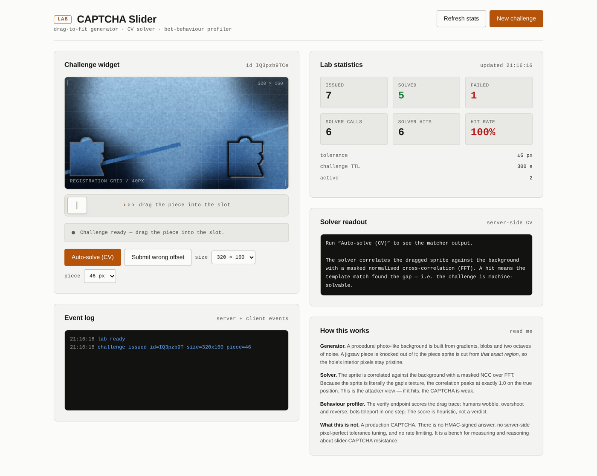
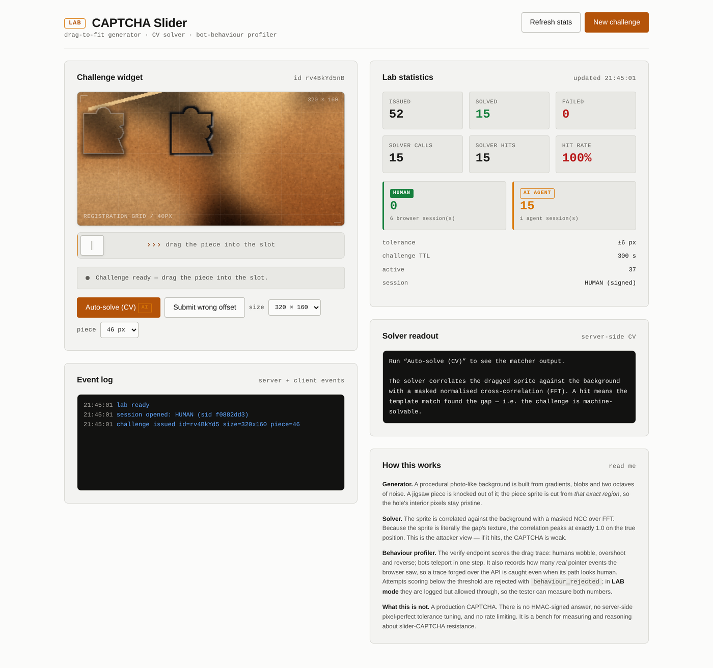

# CAPTCHA Lab — slider puzzle generator & attacker tester

[](README.en.md) · [ES](#captcha-lab--slider-puzzle-generator--attacker-tester)

> **A CAPTCHA is only as strong as its weakest attacker.**
> This project builds the CAPTCHA *and* the attacker that breaks it, then reports
> both numbers honestly.



Generador y banco de pruebas de CAPTCHAs de **deslizador** (drag-to-fit): el reto que
usan hoy casi todas las empresas — una pieza de puzzle que hay que encajar en su hueco.

El lab tiene **dos mitades** y esa es la idea:

| Mitad | Qué hace | Por qué importa |
|---|---|---|
| **Generator** | Emitir retos reales: fondo procedural, pieza jigsaw, hueco, track, scoring de comportamiento | El reto tiene que ser **resoluble por una persona** y **no trivialmente resoluble por una máquina** |
| **Tester** | Lanzar ataques contra el widget y medir qué lo rompe | Un CAPTCHA que un bot resuelve no es un CAPTCHA: es un formulario decorado |

### Lo que este lab demuestra (con números, no con opinions)

| Métrica | Valor | Qué significa |
|---|---|---|
| Solver de CV | **40/40 exactos, 0 px de error** | Un matcher ingenuo encuentra el hueco siempre → la posición nunca fue el problema |
| Ataques en modo producción | **12/15 bloqueados** | Los 3 que pasan son `humanish`: un ataque indistinguible de una persona |
| Atribución | **15/15 → AI AGENT, 0 → HUMAN** | El servidor sabe *quién* resolvió, con tokens firmados |
| Latencia del solver | ~120 ms | Es viable en producción... por eso hace falta el gate de comportamiento |

La conclusión es incómoda y es el punto de todo el lab:

> **Un CAPTCHA sin attestation del servidor es un formulario decorado.**
> Este repo incluye el motivo por el que eso es cierto, medido.

### Diferenciador: distinguir humano / IA



Los tokens de sesión van **firmados con HMAC-SHA256** y el tipo (`human` / `ai_agent`)
está **dentro de la firma**: un agente no puede reetiquetar su token como humano.
El botón *Auto-solve* marca la resolución como IA aunque haya una persona delante.

---

## Arranque rápido

```bash
git clone https://github.com/santilpz28/captcha-lab.git
cd captcha-lab
pip install -r requirements.txt

python3 -m uvicorn app.server:app --host 127.0.0.1 --port 8099
# → http://127.0.0.1:8099
```

Para los tests de bot: `playwright install chromium`.

```bash
python3 tests/test_e2e.py                                  # 40 aserciones
python3 tests/test_bot.py --runs 3 --json out/bot.json     # 5 estrategias de ataque
```

---

## API

### `GET /api/session?kind=human|ai_agent`

Abre una sesión y devuelve un **token firmado**. Es el mecanismo que permite
distinguir una resolución humana de una resolución de IA:

```jsonc
{
  "token": "lab_human.eyJleHAiOjE3OTM1NjkwNzAs….3jXH4LAx-gsZMMm_…",
  "session": {
    "kind": "human", "label": "HUMAN",
    "sid": "44ea8b8c1f3a9d02",
    "issued_at": 1793569070.4, "expires_at": 1793572670.4
  },
  "expires_in": 3600
}
```

- El prefijo es legible a ojo (`lab_human.` / `lab_ai_agent.`).
- La firma es **HMAC-SHA256** sobre `kind.payload` con el secreto del servidor.
- Caduca en 1 h.

> **Por qué importa:** el tipo va *dentro de la firma*. Un agente no puede
> reetiquetar su token como `human` — el servidor rechaza el token con
> firma inválida. Si el tipo fuera solo una etiqueta en el payload, la
> distinción human/AI sería teatro.

Todo el flujo lleva el token en `Authorization: Bearer <token>`:
`/api/challenge`, `/api/verify` y `/api/agent/solve`.

### `GET /api/challenge?width=320&height=160&piece_size=46`

Emite un reto. Devuelve el fondo y la pieza como data URLs, más la geometría que
el cliente necesita para colocar la pieza:

```jsonc
{
  "challenge_id": "…",
  "background": "data:image/png;base64,…",
  "piece":      "data:image/png;base64,…",
  "width": 320, "height": 160, "piece_size": 46,
  "sprite": {            // geometría del PNG de la pieza
    "w": 69, "h": 69,    //   tamaño natural del PNG (incluye halo)
    "opaque_x": 8, "opaque_y": 8,   // caja opaca dentro del PNG
    "opaque_w": 47, "opaque_h": 54
  },
  "piece_rest": {"x": 8,  "y": 45},   // posición de reposo (canvas px)
  "travel":    {"x": 143, "y": 0},   // recorrido hasta el hueco
  "shape_centre": {"x": 174, "y": 81},  // centro de la forma (referencia de verify)
  "session": {"kind": "human", "label": "HUMAN", "sid": "44ea8b8c…"},
  "expires_in": 300
}
```

> **El hueco nunca viaja en el payload.** El ground truth se queda en el servidor.

### `POST /api/verify`

```jsonc
{
  "challenge_id": "…",
  "x": 174, "y": 81,        // centro de la forma en píxeles de canvas
  "trace": [{"x": 12, "y": 300, "t": 0}, …],   // trayectoria del drag
  "duration_ms": 940,
  "pointer_events": 41      // eventos de puntero declarados por el cliente
}
```

Respuesta:

```jsonc
{
  "ok": true,
  "distance_px": 0.5,
  "tolerance_px": 6,
  "solved_by": "human",           // "human" | "ai_agent" | "unknown"
  "solved_by_label": "HUMAN",
  "session_sid": "44ea8b8c…",
  "behaviour": {
    "wobble_ratio": 1.08,   // longitud del trazo / distancia recta
    "path_len": 214.3,
    "samples": 41,
    "duration_ms": 940.0,
    "direction_changes": 3,  // overshoots / retrocesos
    "pointer_events": 41,     // eventos de puntero REALES vistos por el navegador
    "human_score": 1.0
  }
}
```

Un reto es de **un solo uso**: al resolverse se descarta del store (replay → 404).

Si la posición es correcta pero el score comportamental queda por debajo del
umbral, la respuesta es:

```jsonc
{
  "ok": false,
  "reason": "behaviour_rejected",
  "behaviour": {"human_score": 0.05, "pointer_events": 0, …}
}
```

### `POST /api/solve`

Corre el solver de visión por computador contra el reto. **Devuelve la respuesta**
— es deliberadamente accesible, porque el objetivo del lab es medir si el reto es
machacable, no esconderlo.

Marca siempre la resolución como `solved_by: "ai_agent"`: el solver **es** una IA,
y el lab no debe reportar un solve de CV como si lo hubiera hecho una persona.

### `POST /api/agent/solve`

Atajo para agentes: abre una sesión `ai_agent`, resuelve el reto y lo contabiliza
como IA, todo en una llamada.

```jsonc
{
  "ok": true,
  "hit": true,
  "error_px": 0,
  "solved_by": "ai_agent",
  "solved_by_label": "AI AGENT",
  "token": "lab_ai_agent.…",
  "session": {"kind": "ai_agent", "label": "AI AGENT", "sid": "…"},
  "predicted_cx": 174, "predicted_cy": 81
}
```

### `GET /api/stats` · `GET /api/health`

Métricas agregadas y health check. Las estadísticas separan por actor:

```jsonc
{
  "issued": 44, "solved": 17,
  "solved_human": 1,        // resueltos por un humano
  "solved_ai_agent": 11,    // resueltos por una IA / agente
  "solved_unknown": 5,      // resueltos sin token (API anónima)
  "by_actor": {"human": 1, "ai_agent": 11, "unknown": 5},
  "sessions_human": 7, "sessions_ai_agent": 4,
  "solver_calls": 23, "solver_hits": 23, "solver_hit_rate": 1.0,
  "would_block": 12, "blocked": 0
}
```

---

## Cómo funciona por dentro

### Generador (`app/render.py`)

1. **Fondo procedural** — gradientes + blobs de color + 2 octavas de ruido + contraste
   smoothstep + saturación. Nada de stock photos: cada reto es distinto y no
   depende de la red.
2. **Forma jigsaw** — rectángulo con un **diente** arriba y una **muesca** a la derecha.
3. **El hueco conserva la textura original** — es lo que hace el reto *resoluble*:
   el solver tiene contra qué correlacionar. Un hueco con textura inventada haría
   el reto irresoluble (y por tanto inútil).
4. **La pieza se recorta exactamente de la zona del hueco** → lleva la textura que
   tiene que encajar.
5. **Halo y keyline** solo **por fuera** de la forma (dilate − shape). Cualquier
   píxel pintado dentro de la forma corrompería la textura y hundiría la
   precisión del solver de 40/40 a 14/40.

> **El sprite y la plantilla del solver son dos imágenes distintas.** El sprite
> que ve el usuario lleva keyline y drop shadow (que es lo que lo hace legible
> como "pieza levantada"); el solver recibe un crop **prístino** de la misma
> región. Mezclarlos fue exactamente el bug que tumbó la precisión del solver.

### Solver (`app/solver.py`)

Correlación normalizada cruzada **enmascarada** sobre FFT:

- la máscara es la forma, erosionada 2px para saltar el anillo de sombra interior
- el FFT hace que el coste sea independiente del tamaño del canvas
- el pico de la NCC da la posición del hueco

**Precisión medida: 40/40 exactos, error 0 px, ~120 ms.**

### Sesiones y atribución (`app/auth.py`)

El lab distingue tres actores:

| Actor | Cómo llega | Cómo se cuenta |
|---|---|---|
| **HUMAN** | token `lab_human.` firmado | `solved_human` |
| **AI AGENT** | token `lab_ai_agent.` firmado | `solved_ai_agent` |
| **UNKNOWN** | sin token (API anónima) | `solved_unknown` |

El token es `lab_<kind>.<payload_b64>.<sig_b64>`, con la firma
`HMAC-SHA256(kind.payload, SECRET)` y `SECRET` persistido en
`app/.session_secret` (o `CAPTCHA_LAB_SECRET` por entorno).

El widget abre una sesión humana al arrancar. El botón **Auto-solve (CV)**
abre temporalmente una sesión de agente, llama a `/api/solve` y restaura la
sesión humana — así una resolución hecha por el solver **se reporta como IA**,
aunque la persona esté delante. Es la diferencia entre medir el reto y
autoengañarse.

El bot tester (`tests/test_bot.py`) hace lo mismo desde el otro lado: pide un
token de agente y lo inyecta en el widget antes de cada intento, para que el
servidor atribuya a IA un solve que él mismo acaba de provocar.

### Perfilado de comportamiento (`app/server.py`)

Además de la posición, el endpoint de verificación puntúa el **trazo**:

| Señal | Lectura |
|---|---|
| `wobble_ratio` | longitud del trazo ÷ distancia recta. Los humanos van y vienen; los bots van en línea recta |
| `samples` | un humano genera decenas de muestras; un bot, una o dos |
| `duration_ms` | menos de 250 ms es incompatible con un drag real |
| `direction_changes` | overshoots y retrocesos: la firma de un dedo humano |
| `pointer_events` | **cuántos eventos de puntero reales** vio el navegador. Un trazo forjado por API reporta 0 |

El `human_score` va de 0 a 1 y **sí bloquea**: por debajo de `HUMAN_SCORE_MIN`
(0.50) la respuesta es `reason: "behaviour_rejected"`.

La señal decisiva es `pointer_events`. Sin ella, un atacante podía enviar por API
un trazo sintético con forma perfectamente humana (wobble, timing, overshoot) y
colarse con score 0.55. Con ella, el mismo trazo forjado baja a 0.05 y se
bloquea — porque **no hubo ningún dedo detrás**.

> **Honestidad sobre el límite.** `pointer_events` lo reporta el cliente, así que
> un atacante con control del navegador puede mandar un número falso. Esto no es
> attestation: es una heurística que eleva el coste del ataque trivial. La
> lesson real sigue siendo la del final: sin attestation del servidor, un CAPTCHA
> es un formulario decorado.

---

## Tester de bots (`tests/test_bot.py`)

```bash
python3 tests/test_bot.py --url http://127.0.0.1:8099 --runs 3 --json out/bot-report.json
```

| Estrategia | Qué simula | Resultado |
|---|---|---|
| `teleport` | un salto de ratón directo al objetivo (bot de CV ingenuo) | **bloqueado** — score humano 0.00 |
| `linear` | drag a velocidad constante | **bloqueado** — score humano 0.40 |
| `humanish` | drag con easing, overshoot y pausa antes de soltar | **resuelve** — score humano 0.55–1.00 |
| `no_mouse` | llama al endpoint de verify con un trazo sintético | **bloqueado** — score humano 0.05 |
| `api_only` | pide la solución a `/api/solve` | **bloqueado** — score humano 0.00 |

Última medición en **modo producción** (`LAB_MODE = False`, 3 runs por estrategia):

```
position solved:      3/15
blocked by gate:      12/15
EFFECTIVE bypasses:   3/15
```

Los 3 bypasses son **todos `humanish`**, es decir un ataque que se comporta como
una persona real (easing, overshoot, pausa antes de soltar). **Es el resultado
correcto**: el CAPTCHA resiste a la automatización y sólo cede ante algo
indistinguible de un humano.

El tester se identifica a sí mismo como **agente**: pide una sesión `ai_agent`
y la inyecta en el widget antes de cada intento, así que el servidor atribuye
cada resolución a IA y no a un humano. Sin eso, un bot que controla el widget
se contabilizaría como humano y la métrica sería falsa:

```
position solved:      10/10
blocked by gate:      0/10
EFFECTIVE bypasses:   10/10
attributed to HUMAN:  0   AI AGENT: 10
```

En **modo lab** (`LAB_MODE = True`) el gate se registra pero no bloquea, para
poder medir ambas cifras a la vez:

```
position solved:      15/15
would-block:          12/15
```

La lección de seguridad que el lab deja sobre la mesa es la de siempre, pero ahora
**con un gate que funciona**: la posición nunca fue el problema — el solver
acierta el hueco con 0 px de error el 100% de las veces. Lo que separa un ataque
automático de uno indistinguible de un humano es el comportamiento. Y lo que
sigue faltando para un despliegue real es **algo que la API sola no pueda
falsificar**: un challenge firmado atado a la sesión, attestation del cliente
(WebAuthn/Turnstile), o una señal de comportamiento côté serveur que no dependa
del cliente que la reporta. Este lab deja esa pieza deliberadamente fuera de
alcance — y la señala.

---

## Tests (`tests/test_e2e.py`)

```
35 passed, 0 failed
```

- geometría: la pieza siempre cabe dentro del canvas (40/40)
- textura: el sprite encaja con el hueco (mad < 2 niveles, corr > 0.95)
- solver: exacto en 40/40, dentro de tolerancia en 40/40, < 500 ms
- API: no filtra el ground truth, un reto no se puede reusar, un offset
  equivocado se rechaza, un drag humano puntúa alto y uno bot-like bajo
- gate: un trazo forjado por API (sin eventos de puntero) puntúa bajo y se
  marca como bloqueable; **el mismo trazo con eventos de puntero se acepta**
- sesiones: el token humano y el de agente se emiten con prefijos legibles; el
  tipo **no se puede degradar** (un token de agente reetiquetado como humano se
  rechaza); el tipo hace round-trip exacto por el token; un solve con token
  humano se atribuye a HUMAN y el flujo de agente a AI AGENT; las estadísticas
  separan ambos contadores
  — es decir, el gate discrimina por procedencia, no por la forma del trazo

---

## Modos de ejecución

El gate comportamental se controla con dos constantes en `app/server.py`:

```python
HUMAN_SCORE_MIN = 0.50   # por debajo de esto, el intento se rechaza
LAB_MODE = True          # True: registra pero deja pasar
```

| Modo | Para qué | Comportamiento |
|---|---|---|
| `LAB_MODE = True` | investigar | El bypass se registra (`would_block: true`) pero no se bloquea. Sirve para medir **qué** winning y qué no |
| `LAB_MODE = False` | producción | El bypass se rechaza con `reason: "behaviour_rejected"` |

`/api/stats` expone `blocked`, `would_block`, `human_score_min` y `lab_mode`.

---

---

## Estructura

```
tools/captcha-lab/
├── app/
│   ├── tokens.py     # paleta, tipografía, espaciado, constantes del canvas
│   ├── auth.py       # tokens de sesión firmados (human vs ai_agent)
│   ├── render.py     # generador procedural + compositor Pillow
│   ├── solver.py     # NCC enmascarada sobre FFT
│   └── server.py     # FastAPI + store + scoring de comportamiento
├── static/           # el widget (HTML/CSS/JS sin framework)
├── tests/
│   ├── test_e2e.py   # 35 aserciones
│   └── test_bot.py   # 5 estrategias de ataque con Playwright
└── out/              # capturas y reportes
```

---

## Notas de implementación (las que costaron sangre)

**El separador del token: un bug de una línea que partió todo.** El token se
emitía como `lab_<kind>_<payload>.<firma>` y se parseaba con
`body.split("_", 1)`. Como el propio tipo contiene un underscore
(`ai_agent`), el split cortaba el tipo por la mitad: `ai_agent` → `ai`. El
resultado era que **ningún token validaba**, siempre. Pero — y esto es lo
interesante — el flujo seguía *pareciendo* funcionar: el `fetch` del navegador
mandaba el token, el servidor respondía `kind: unknown`, y nadie miraba el
detalle porque todo lo importante (posición, gate, stats) ya estaba en su sitio.
Un token mal parseado no rompe el sistema; **lo degrada en silencio hasta
que deja de distinguir nada**, que es justo lo contrario de lo que promete.

La regla que sale de ahí: *un clasificador que no clasifica es peor que no
tener clasificador*, porque la gente confía en el número. Por eso los tests
afirman el round-trip exacto del tipo, no solo que el token "parezca válido".

**El tipo va dentro de la firma, no en el payload.** Si el tipo fuera un campo
normal del payload (`{"kind": "human", …}`), un agente podría reetiquetar su
propio token a `human` sin tocar la firma. Al estar el tipo firmado, el
servidor rechaza el token alterado. Es la diferencia entre *etiquetar* y
*atestiguar*: sólo la segunda resiste a un actor hostil.

**`pointer_events` no es attestation.** Es un número que manda el cliente. Un
atacante con control del navegador puede enviar el que quiera. Sirve para
elevar el coste del ataque trivial, no para cerrar la puerta. Lo que sí es
falso aquí es la pretensión: el lab lo documenta en vez de venderlo como
garantía.

**Unidades de coordenadas.** Hay tres espacios: píxeles de canvas (320×160),
píxeles CSS (escalados ~1.64×) y píxeles de pantalla. La pieza se reporta en
píxeles de canvas; el drag ocurre en píxeles CSS. El `scale` se deriva en
tiempo de ejecución del `getBoundingClientRect()` del canvas, nunca se
hardcodea — si el layout cambia, la escala se ajusta sola.

**La pieza flota sobre el canvas, no dentro del track.** El track es solo el
asa. La pieza tiene que compartir **exactamente** la fila del hueco, y eso solo
se garantiza si es un elemento hermano posicionado en absoluto sobre la placa.

**Una sola fuente de verdad para la geometría.** `piece_rest` + `travel` +
`sprite.opaque_*` describen la posición de la forma; el cliente deriva de ahí
el centro que se envía a verificar. Cuando el cliente y el servidor usaron
referencias distintas (centro del cuerpo cuadrado vs. centro de la forma
opaca), el error fue de 20 px constantes — el tell-tale de un desalineamiento
estructural, no de un bug de aritmética.

**`paste` con máscara REEMPLAZA el canal alpha.** Pintar un tinte con
`paste(im, box, mask)` destruye el alpha del tinte y deja un cuadrado opaco.
Hay que componer con `alpha_composite`. Este bug se manifiestó como "el sprite
es un cuadrado negro" y costó dos iteraciones.

**Un `pointermove` antes del `pointerdown` no es un drag.** El cliente sembraba
el trazo sólo con los `pointermove`, así que un salto de ratón (mover → soltar)
llegaba con el trazo vacío y el widget respondía "arrastra la pieza". La
solución: sembrar el trazo en el `pointerdown` y añadir el punto de soltado en
el `pointerup`. Un drag de un solo salto produce así un trazo válido de dos
puntos.

**Medir, no suponer.** La primera versión del gate puntuaba el trazo pero
**nunca bloqueaba**: el `human_score` se calculaba y se ignoraba. El informe
del tester lo delató — "15/15 ataques exitosos" con `humanish` en 1.00 y
`api_only` en 0.20, la misma cifra que antes de añadir el gate. La métrica
que faltaba no era el score, sino **la tasa de bypass efectivo**: cuántos
ataques derrotan de verdad el CAPTCHA, no cuántosRespaldan la API.

**El contraste del hueco hay que medirlo, no suponerlo.** Medido sobre 12
seeds, el contraste de luminancia entre el hueco y su entorno era de 0.6–4.2
en la mitad de los casos: el hueco era invisible salvo por una keyline de 1px.
El arreglo (keyline más gruesa + rim especular + sombra interior más profunda)
subió el contraste del contorno a 26–134 en 11 de 12 seeds **sin tocar la
textura interior**, que es lo que el solver correlaciona.

**Un hueco debe leerse como hueco, pero su interior no puede cambiar.** Esa
tensión es el corazón del reto: si oscureces el interior, el solver pierde
la textura y deja de resolver; si no, el humano no ve dónde encajar. La
solución es mover toda la señal visual **hacia fuera** de la forma (keyline,
sombra proyectada, rim especular) y dejar el interior byte-idéntico al fondo.

---

## Licencia / uso

Herramienta de laboratorio educativo. Úsala para entender y para medir la
resistencia de tu propio despliegue; no la despliegues como CAPTCHA en
producción — para eso, un servicio gestionado (Cloudflare Turnstile, hCaptcha,
reCAPTCHA Enterprise) te da attestation que este lab no puede darte.
